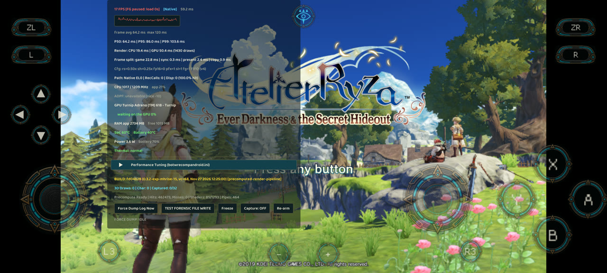
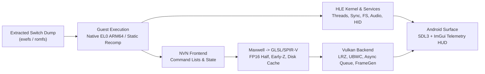

# RyzaNativeAndroid

**Native ARM64 & Static Recompilation runtime for running *Atelier Ryza: Ever Darkness & the Secret Hideout* (Nintendo Switch, KTGL engine) on Android via NVN-to-Vulkan translation.**

[](https://github.com/EkoSaputro14/RyzaNativeAndroid/actions/workflows/android-release.yml)
[](https://github.com/EkoSaputro14/RyzaNativeAndroid/releases)
[%20%7C%20arm64--v8a-3DDC84?logo=android&logoColor=white)](https://github.com/EkoSaputro14/RyzaNativeAndroid/releases)
[](#core-engineering-highlights-expmhrise-arch)
[](LICENSE)

> [!NOTE]
> **No game files, DLC, or decryption keys are included or distributed.**
> You must supply your own legally obtained, decrypted and extracted *Atelier Ryza* Nintendo Switch dump (`exefs` and `romfs`). RyzaNativeAndroid does not open NSP/XCI containers or accept `prod.keys`.

---

## Preview



*Title scene (`TT01` / `S19_L_HIGHWAY_03`) rendered on POCO X3 NFC (Snapdragon 732G, Adreno 618 + Mesa Turnip) with the built-in real-time telemetry HUD and `exp/mhrise-arch` renderer optimizations.*

---

## Architecture Overview

RyzaNativeAndroid is **not a Switch system emulator**. Guest ARM64 binaries run directly on the device CPU via Native `EL0` execution (or static recompilation into C), while OS/kernel primitives (`svc`, threading, synchronization, filesystem, audio, HID) are handled by a native HLE layer and Nintendo NVN graphics commands are dynamically compiled to Vulkan 1.3.



---

## Core Engineering Highlights (`exp/mhrise-arch`)

Active development on the `exp/mhrise-arch` branch focuses on Adreno/Turnip GPU efficiency, zero-stall synchronization, and shader ALU reduction:

- **Maxwell-to-GLSL / SPIR-V Compiler (`runtime/nvn/maxwell/`)**:
  - Native `f16vec2` lowering for Maxwell `H*2` half-float instructions in both fragment and vertex stages (`maxwell_fp16_half`, `maxwell_vs_native_half`).
  - Pure half-domain `hpack_lo16` / `hpack_hi16`, `TEX.F16`, `F2F.F16`, `I2F.F16`, `F2I.F16`, and fast 32-bit `IADD32I` paths.
  - Zero-copy `layout(early_fragment_tests) in;` emission via `want_early_z` and `ShaderKey.no_ds_write` for post-prepass alpha-tested lit draws.
  - Shadow-off shader variant pruning (`ShaderKey.no_shadow`) and persistent on-disk SPIR-V compilation cache.
- **Adreno / Turnip Vulkan Renderer (`runtime/nvn/vulkan/`)**:
  - `fast_depth` Adreno LRZ preservation with strict cutout-only (`uses_discard || writes_depth`) tracking.
  - Depth-only `stageCount = 1` pipeline optimization when fragment output/side effects are absent (`ncolor == 0 && !a2c && !uses_discard && !writes_depth && !uses_gmem_store`).
  - Full Turnip UBWC compression on color render targets, `tiler_store_none` (`VK_ATTACHMENT_STORE_OP_NONE` + tight `renderArea`), and empty barrier elision (`tight_barriers`, `barrier_bits`).
  - Single-submit frame command batching, per-submission `VkFence` polling with monotonic sequence caching, and asynchronous small texture-to-buffer readbacks.
- **Execution, Pacing & Telemetry (`runtime/hle/`, `runtime/ui/`)**:
  - Configurable `sync_lag` pipelining, background async shader compilation (`async_shaders`), and persistent `PipeKey` pipeline cache warmup.
  - Optional 2x frame generation (`frame_gen`: Light / Balanced) with pre-warmup overload hysteresis gating.
  - KTGL post-FX culling (`skip_postfx`), real-time ImGui performance HUD (CPU/GPU/frame-split telemetry), and on-demand per-pass GPU profiling (`gpuprof_once` -> `gpuprof_last.txt`).

---

## System Requirements & Tested Hardware

| Component | Requirement / Tested Target | Notes |
| :--- | :--- | :--- |
| **OS** | Android 9.0+ (`minSdk = 28`, `targetSdk = 34`) | Built and tested for `arm64-v8a` only |
| **Graphics API** | Vulkan 1.1+ / Vulkan 1.3 | Adreno GPUs benefit strongly from a Mesa Turnip driver selected via the built-in `libadrenotools` loader |
| **Game Data** | Extracted Switch dump (`exefs` + `romfs`) | Supports in-place access (All-Files Access permission) or internal app-storage copy |
| **Primary Test Device** | POCO X3 NFC (Snapdragon 732G, Adreno 618) | Verified on hardware with Mesa Turnip driver (`1920x1080` internal / `0.50x` render scale tuning) |

---

## Installation & Quick Start

1. Download the latest `arm64` APK from [GitHub Releases](https://github.com/EkoSaputro14/RyzaNativeAndroid/releases) and install it on your Android device.
2. Prepare a folder containing your legally extracted *Atelier Ryza* `exefs` and `romfs` directories.
3. Launch the app and point **Game Files** to your extracted directory (**Use them in place** avoids duplicating ~16 GB into app storage; **Copy them** copies data into the app sandbox).
4. Choose **Native** execution (direct ARM64 `EL0`) or **Recompiled** mode depending on your setup.
5. *(Adreno devices)* Under **Settings > Files > Vulkan driver**, load a compatible Mesa Turnip `.zip` driver for best rendering correctness and LRZ/UBWC performance.
6. If you encounter an issue, open a ticket in [Issues](https://github.com/EkoSaputro14/RyzaNativeAndroid/issues) attaching your device model, GPU/driver version, game version, and log captured via **Settings > Files > Save a log file**.

---

## Configuration & Tuning (`botwrecompandroid.ini`)

Settings are stored at `/sdcard/Android/data/com.botwrecomp.android/files/botwrecompandroid.ini` and can be adjusted live from the in-game menu (`F1`, `Esc`, or `Minus + Plus` on a controller).

> [!NOTE]
> **Legacy Identifier Compatibility:** This repository is dedicated to *Atelier Ryza* (**RyzaNativeAndroid**). Internal package/config identifiers such as `com.botwrecomp.android`, `android/botwrecompandroid/`, `botwrecompandroid.ini`, and `LARECOMP_*` env flags are intentionally kept unchanged for save-data and build compatibility with the upstream base.

| Key | Recommended / Typical Value | Description |
| :--- | :---: | :--- |
| `render_scale` | `0.50` .. `1.00` | Internal 3D scene resolution scale (`0.50` / `0.68` recommended on mid-range Adreno) |
| `shadow_scale` | `0.00`, `0.25`, `0.50`, `1.00` | Shadow map resolution scale (`0.00` disables shadow map rendering) |
| `target_fps` | `0`, `20`, `30`, `45`, `60` | Frame pacer target (`0` = uncapped) |
| `skip_postfx` | `0` / `1` | Culls heavy KTGL post-processing passes when set to `1` |
| `fast_depth` | `1` | Enables Adreno LRZ preservation (`EQUAL` -> `GEQUAL`/`LEQUAL`) |
| `tight_barriers` / `barrier_bits` | `1` / `1` | Elides redundant barriers and narrows pipeline stage scopes |
| `tiler_store_none` | `1` | Uses `STORE_OP_NONE` and tight render areas for tile-based GPUs |
| `frame_gen` | `0`, `1`, `2` | Frame generation mode (`0` = off, `1` = 2x Light, `2` = 2x Balanced) |
| `async_shaders` | `1` | Enables non-blocking background shader/pipeline compilation |
| `sync_lag` | `1` | 1-frame GPU/CPU pipelining mode (`0` = off, `1` = pipelined, `2` = store guard) |
| `fp16_shaders` | `0` / `1` | Shader RelaxedPrecision toggle (`0` = FP32 fragment baseline, `1` = FP16) |
| `gpu_unswizzle` | `0` / `1` | GPU compute vs CPU texture deswizzling |
| `heap_mb` / `swapchain_images` / `present_mode` | `2560` / `4` / `2` | Memory arena size (MB), swapchain count (`2..5`), present mode (`0` immediate, `1` mailbox, `2` FIFO) |

---

## Building from Source & Verification

### Automated CI Build
Pushes to `main`, `exp/*`, or `v*` tags trigger [`.github/workflows/android-release.yml`](.github/workflows/android-release.yml), which builds the `arm64-v8a` native runtime, Gradle debug/release APKs, and publishes `SHA256SUMS.txt` on GitHub Releases.

### Local Android Build
With the Android SDK/NDK installed and third-party dependencies staged in `android/deps/out` (via `android/deps/build_deps.sh`):

```bash
cd android/botwrecompandroid
./gradlew assembleDebug    # Debug APK
./gradlew assembleRelease  # Release APK
```

### Host Regression Tests
Run the Python architectural guard suite and C unit tests before committing runtime changes:

```bash
python3 companion/tests/test_ryza_fixes.py
gcc -O2 -Iruntime companion/tests/test_ryza_fixes.c -o /tmp/test_ryza_fixes_c -lm && /tmp/test_ryza_fixes_c
```

---

## Repository Layout

| Path | Purpose |
| :--- | :--- |
| `runtime/nvn/maxwell/` | Maxwell GPU shader decoder, GLSL/SPIR-V translator, and FP16/Early-Z passes |
| `runtime/nvn/vulkan/` | Vulkan command execution, memory mirrors, async queue, FrameGen, shader/pipeline cache, and GPU profiler |
| `runtime/hle/` | High-level Switch OS kernel, filesystem, audio, HID, and thread synchronization HLE |
| `runtime/ui/` | ImGui settings overlay, performance HUD, custom driver selector, and touch controls |
| `android/botwrecompandroid/` | Android Gradle project, JNI glue, CMake native build (`libmain.so`) |
| `companion/tests/` | Host regression suites (`test_ryza_fixes.py`, `test_ryza_fixes.c`) |
| `.github/workflows/` | GitHub Actions APK build and release workflow (`android-release.yml`) |

---

## Contributing

Contributions, device test reports, and GPU profiling feedback are welcome! Please read [CONTRIBUTING.md](CONTRIBUTING.md) before opening a pull request or issue (strict rule: never upload dumps, `exefs`/`romfs`, generated guest code, or game assets).

---

## Credits & Upstream Attribution

RyzaNativeAndroid stands on the shoulders of upstream recompilation and Android Vulkan engineering projects:

- **[BOTWRecompAndroid](https://github.com/mamcjr/BOTWRecompAndroid)** by [mamcjr](https://github.com/mamcjr) — upstream Android NVN-to-Vulkan codebase, touch controls overhaul, mod loader, and driver compatibility foundation.
- **[LAS Recomp](https://github.com/peiikai/LASRecomp)** by [peiikai](https://github.com/peiikai) — original static recompiler and runtime engine (MIT, [LICENSE](LICENSE)). Original upstream README files remain under `docs/las/`.
- **[LASRecompAndroid](https://github.com/mamcjr/LASRecompAndroid)** — original Android app scaffolding, on-device build integration, and multi-language UI.
- **[SavageWindRecomp](https://github.com/Revivedx/SavageWindRecomp)** by [Revivedx](https://github.com/Revivedx) (MIT) — frame pacing, internal resolution, SDK 20 kernel fixes, and `setjmp` reference.
- **[MacNativeGames](https://github.com/ly05010419/MacNativeGames)** by [ly05010419](https://github.com/ly05010419/MacNativeGames) (MIT) — sync lag, GPU readbacks, heightmap/texture layout, gyro drift fixes, and Native ARM64 execution insights.
- **[totk-mobile](https://github.com/OJZen/totk-mobile)** by [OJZen](https://github.com/OJZen) and **[d2r-mobile](https://github.com/jhaizhou-ops/d2r-mobile)** by [jhaizhou-ops](https://github.com/jhaizhou-ops) — Native `EL0` execution architecture reference.
- **LASRecomp-Android-Plus** by [Nycolazs](https://github.com/Nycolazs) (MIT) — Vulkan driver compatibility notes.
- **Third-Party Libraries & Drivers**:
  - [SDL](https://libsdl.org) (zlib), [Dear ImGui](https://github.com/ocornut/imgui) (MIT), [libadrenotools](https://github.com/bylaws/libadrenotools) (BSD-2-Clause), [volk](https://github.com/zeux/volk) (MIT), [Vulkan Memory Allocator](https://github.com/GPUOpen-LibrariesAndSDKs/VulkanMemoryAllocator) (MIT), [shaderc](https://github.com/google/shaderc) (Apache 2.0)
  - [FFmpeg](https://ffmpeg.org) (LGPL), [LZ4](https://github.com/lz4/lz4) (BSD-2-Clause), [Capstone](https://www.capstone-engine.org) (BSD-3-Clause), [Unicorn](https://www.unicorn-engine.org) (GPLv2), [Python](https://www.python.org) (PSF), [Zig](https://ziglang.org) (MIT)
  - Upscaling & AA: [AMD FidelityFX FSR 1](https://github.com/GPUOpen-Effects/FidelityFX-FSR) (MIT), [Qualcomm Snapdragon GSR](https://github.com/SnapdragonStudios/snapdragon-gsr) (BSD-3-Clause), [SMAA](https://github.com/iryoku/smaa) (MIT)
  - Custom Qualcomm Vulkan Driver Support: [Mesa Turnip](https://www.mesa3d.org) (MIT, user-loaded)
  - Fonts: [Baloo 2](https://github.com/EkType/Baloo2) (OFL), DejaVu Sans (Bitstream Vera license)

---

## License & Disclaimer

Licensed under the [MIT License](LICENSE) for original runtime and recompiler code; bundled third-party submodules remain under their respective licenses.

*Atelier Ryza: Ever Darkness & the Secret Hideout*, *KTGL*, and related trademarks belong to Koei Tecmo Games / Gust. *Nintendo Switch* belongs to Nintendo Co., Ltd. This project is an independent, non-commercial technical effort and is not affiliated with or endorsed by Koei Tecmo Games, Gust, or Nintendo.
